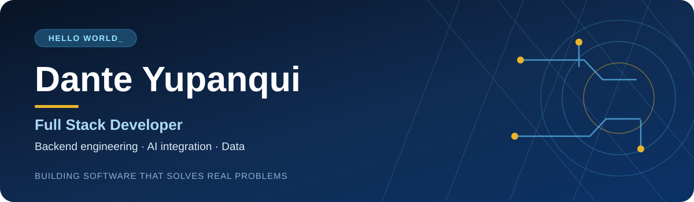
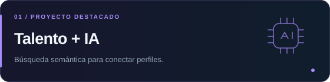
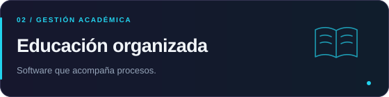
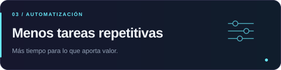
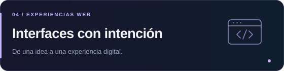
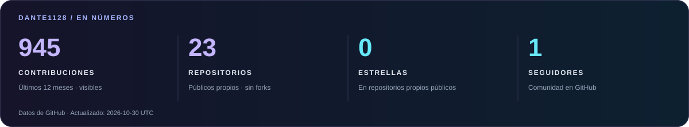
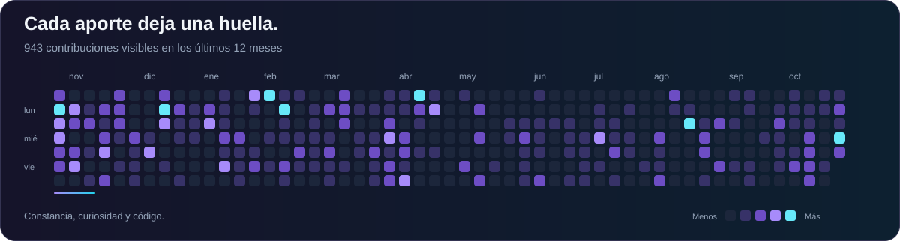
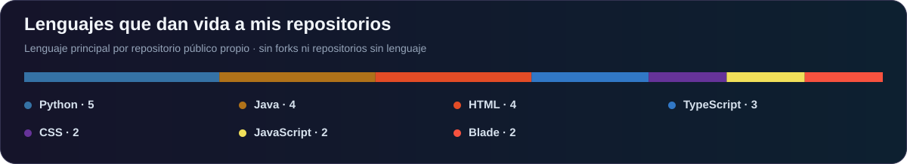

**Egresado de Ingeniería de Sistemas · La Paz, Bolivia**

Transformo ideas en aplicaciones que conectan **software, datos e inteligencia artificial**.

&nbsp;

 

[Sobre mí](#-el-desarrollador-detrás-del-código) &nbsp; · &nbsp; [Tecnologías](#-mi-universo-tecnológico) &nbsp; · &nbsp; [Proyectos](#-ideas-convertidas-en-proyectos) &nbsp; · &nbsp; [Actividad](#-mi-actividad-en-github) &nbsp; · &nbsp; [Conectemos](#-de-la-idea-al-siguiente-proyecto)

## 👨‍💻 El desarrollador detrás del código

Soy **Dante Yupanqui**. Disfruto construir aplicaciones de principio a fin, con especial interés en lo que sucede detrás de cada interfaz: **APIs, lógica de negocio, bases de datos e integraciones**.

<table>
<tr>
<td width="50%" valign="top">

### ⚡ Lo que construyo

Aplicaciones **Full Stack**, servicios backend y automatizaciones que convierten procesos repetitivos en herramientas útiles.

</td>
<td width="50%" valign="top">

### 🧠 Lo que me mueve

Aplicar **LLMs, embeddings y búsqueda semántica** a problemas concretos. Sigo profundizando en arquitectura backend y agentes de IA.

</td>
</tr>
</table>

## 🛠️ Mi universo tecnológico

Un stack para construir, conectar y automatizar.

<table>
<tr>
<td width="50%" align="center" valign="top">
<h3>⌨️ Lenguajes</h3>

Python · PHP · JavaScript · TypeScript · Dart · SQL

</td>
<td width="50%" align="center" valign="top">
<h3>⚙️ Backend</h3>

Laravel · Django · Flask · Node.js · Express

</td>
</tr>
<tr>
<td width="50%" align="center" valign="top">
<h3>🎨 Frontend &amp; móvil</h3>

Vue.js · React · Astro · Flutter

</td>
<td width="50%" align="center" valign="top">
<h3>🗄️ Bases de datos</h3>

PostgreSQL · pgvector · MySQL · MongoDB · Firebase

</td>
</tr>
<tr>
<td width="50%" align="center" valign="top">
<h3>🧠 IA &amp; automatización</h3>

Ollama · LLMs · Embeddings · Selenium · pandas

</td>
<td width="50%" align="center" valign="top">
<h3>🔧 Herramientas</h3>

Git · GitHub · Docker · Postman

</td>
</tr>
</table>

## 🚀 Ideas convertidas en proyectos

Tecnología aplicada a personas, procesos y experiencias.

<table>
<tr>
<td width="50%" valign="top">

**Preselección de personal con IA**

Análisis de currículums y comparación con vacantes mediante **embeddings, búsqueda vectorial y similitud semántica**.

`Vue.js` `Laravel` `PostgreSQL` `pgvector` `Ollama`

</td>
<td width="50%" valign="top">

**Sistema de administración académica**

Funcionalidades para gestionar y organizar **procesos académicos** dentro de una plataforma web.

`Laravel` `PHP` `MySQL`

</td>
</tr>
<tr>
<td width="50%" valign="top">

**Automatización y extracción de datos**

Scripts para **recopilar información, procesar datos y agilizar tareas** que antes requerían trabajo manual.

`Python` `Selenium` `pandas`

</td>
<td width="50%" valign="top">

**Interfaces y experiencias web**

Desarrollo de interfaces y experiencias digitales **orientadas a las personas** que las utilizan.

`React` `Astro` `JavaScript`

</td>
</tr>
</table>

Proyectos de mi trayectoria. Explora el código público disponible en mis repositorios.

[**Ver repositorios ↗**](https://github.com/Dante1128?tab=repositories)

## 📈 Mi actividad en GitHub

Cada proyecto, cada aporte y cada línea de código forman parte del camino.

 

 

Datos reales de GitHub. La fecha de actualización aparece en la tarjeta.

## 🤝 De la idea al siguiente proyecto

Me interesa colaborar en proyectos donde pueda **aportar, aprender y construir soluciones útiles**.

  

Hecho con curiosidad, código y ganas de seguir creando. ✦

